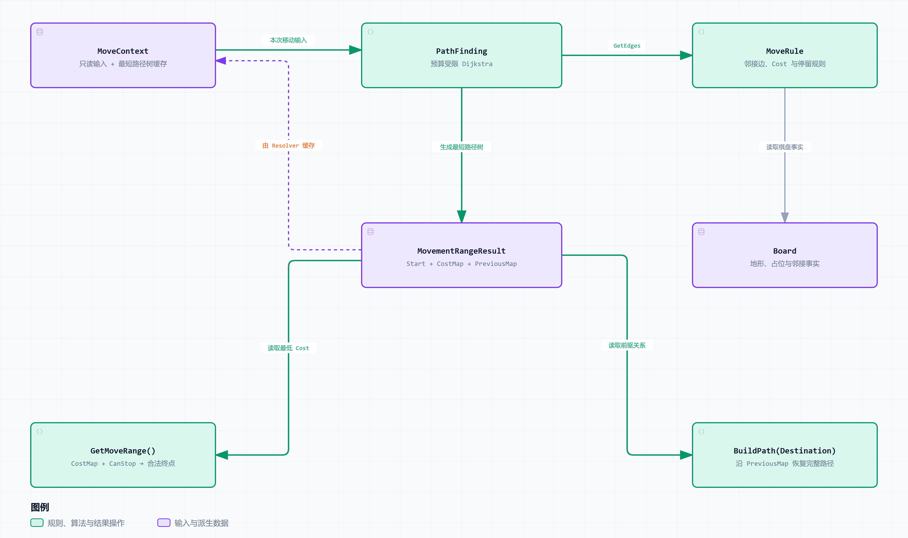

# ADR-007：移动系统与寻路算法解耦

> 状态：已确定
>
> 创建日期：2026-10-27
>
> 决策日期：2026-10-27
>
> 本记录描述架构决策；“已确定”不表示接口已定稿或代码已实现。建议实现与未决技术细节仍按正文标记处理，实现与验证进展见第 7 节。

## 1. 背景

项目已有基于六边形网格的战棋原型，并实现了 A* 寻路。现计划在已有成果上渐进重构移动系统，使其与上层战斗流程解耦，并为不同棋盘类型、地形费用、飞行和单位占位等规则保留扩展边界。

本次优先复用六边形网格和 A*，不涉及移动动画、Hook、技能、移动中断及完整战斗执行流程，也不要求立即实现方形棋盘。

上述已有实现来自用户说明；当前仓库没有对应的 C++ 源码，具体耦合位置和可复用范围仍需接入时核对。HTML 战斗原型未包含移动，不作为移动重构已经完成的证据。

2026-10-28 补充：[独立方格移动原型](../../../Prototype/MovementREADME.md)已用于验证预算树复用、地面 / 飞行和逐格事件；它与现有战斗原型分别运行，不代表六边形 C++ 迁移已经完成。执行与事件约定见[实现记录](../../Implementation/Movement/方格移动原型.md)，属于本次演示，不在本 ADR 中扩充为正式 Hook 决策。

## 2. 面临的问题

如何解耦现有六边形网格、移动规则与 A*，让同一移动入口支持范围查询和目标路径计算，并复用已经得到的搜索结果？

主要判断标准是职责清晰、复用已有代码、规则一致、结果正确，以及第一版改动范围可控。本次重点明确一次搜索结果如何同时服务范围显示与路径恢复，以及缓存使用条件和查询到执行之间的交接。

## 3. 候选方案

### 3.1 棋盘与移动规则的依赖方式

| 方案 | 核心做法 | 优点 | 代价与风险 |
| --- | --- | --- | --- |
| A：直接依赖 Board | PathFinding 查询 Board，并处理地形、占位等移动规则 | 初期改动较少 | 算法与地图及业务耦合，扩展时需要修改搜索器 |
| B：预生成移动图 | MoveRule 根据棋盘和单位状态生成带权图，再交给搜索器 | 可以复用预处理结果 | 需要维护额外图数据及其失效机制 |
| C：动态查询 MoveRule | 搜索时获取允许的邻接边及 Cost，规则层解释棋盘事实 | 职责清晰，适合渐进迁移 | 同一规则可能重复计算，实际开销需验证 |

### 3.2 生成移动范围结果的搜索算法

原有战棋使用 A*，解决从指定起点到指定终点的最短路径问题。当前移动规划需要在玩家选择 Destination 之前，根据单位移动力计算所有可达格及其最低费用，因此需要比较两种搜索方式对这一输出目标的适用性。

| 方案 | 核心做法 | 优点 | 代价与适用边界 |
| --- | --- | --- | --- |
| 沿用原有单目标 A* | 给定起点和终点，通过启发函数引导搜索，确定目标最短路径后结束 | 可复用已有实现，适合目标已确定的路径查询 | 一次单目标搜索不保证得到预算内所有格子的最低费用与前驱；其部分结果不能直接支撑完整范围显示 |
| 带移动预算的 Dijkstra | 从单位当前位置出发，按累计 Cost 扩展，完成预算内所有可达节点的搜索 | 无需预先指定终点，一次生成最低费用与前驱树，可供范围显示和任意合法目标的路径恢复复用 | 单次搜索需要覆盖整个预算范围；实际时间与内存开销待验证 |

**选择带移动预算的 Dijkstra。** 依据是当前需要的完整单源搜索结果，而非宣称 Dijkstra 在所有场景都比 A* 更快。已有 A* 的基础组件仍可复用；若将其启发值设为 0，并取消单目标提前结束条件来完成预算范围搜索，其搜索方式即按 Dijkstra 处理。

## 4. 最终决定

**依赖方式采用第 3.1 节的方案 C，通过 MoveRule 解耦寻路算法与棋盘数据；搜索算法采用第 3.2 节的预算受限 Dijkstra，一次生成可复用的最短路径树，移动范围显示与目标路径恢复共享该结果。** 由 MoveContext 缓存 MovementRangeResult，MoveResolver 协调它的生成、校验与使用。具体接口组织、缓存字段等建议实现和第 7 节未决事项继续保留。

### 4.1 已确定的设计方向与模块职责

- **Board**：提供格子、地形、高度、占位和邻接事实，优先复用六边形实现。对外使用 CellId，坐标换算留在 Board 层。
- **CombatState**：提供单位当前所在格、移动预算、移动类型和影响移动的状态。
- **MoveRule**：结合 Board 与只读移动输入，解释通行关系、移动 Cost 和合法停留位置。
- **PathFinding**：通过通用邻接提供者调用 MoveRule，进行预算受限的带权图搜索，生成最短路径树；不依赖具体棋盘或单位业务类型。已有 A* 可保留为独立单目标能力。
- **MoveContext**：保存本次单位移动输入及临时规划结果，属于派生数据，不是权威状态。
- **MovementRangeResult**：保存 Start、CostMap 和 PreviousMap，表达从起点出发、受移动预算约束的最短路径树，同时支持范围提取和路径恢复。
- **MoveResolver**：作为统一入口，协调当前输入、缓存、搜索、目标校验和路径恢复，输出待执行的移动计划。



[打开可交互架构图](../Diagrams/movement-architecture.html) · [查看 SVG](../Diagrams/movement-architecture.svg)

图聚焦规划数据流与结果复用，不表示继承或完整调用时序。PathFinding 通过绑定只读 Input / Board 的邻接提供者访问规则；MoveResolver 负责调度并将结果存入 Context，CombatState 提供输入来源。图中的数据对象不要求使用数据库或 UObject。

### 4.2 核心结果：预算约束下的最短路径树

MovementRangeResult 的核心结构如下，代码用于表达字段语义，不表示 UE 接口已经实现：

```cpp
struct FMovementRangeResult
{
    FCellId Start;
    TMap<FCellId, int32> CostMap;
    TMap<FCellId, FCellId> PreviousMap;
};
```

CostMap 保存预算内各可达格的最低累计移动费用，PreviousMap 为每个可达格保留一个最优前驱；起点 Cost 为 0，没有前驱。它们共同表达一棵以 Start 为根的最短路径树，不需要为每个目的地保存完整路径。

同一份 Result 直接支持两种操作：

| 操作 | 使用的数据 | 行为 |
| --- | --- | --- |
| GetMoveRange() | CostMap + 同版本的停留规则 | 从可达节点中筛选所有合法移动终点，用于高亮等展示 |
| BuildPath(Destination) | Start + PreviousMap；CostMap 提供可达性与费用 | 从目标反向追溯至起点，恢复一条完整路径，不再次搜索 |

这里描述结果支持的逻辑操作；GetMoveRange 的实际接口需要显式接收或由调用侧绑定同版本停留判断，不能要求数据对象独自理解规则。成员函数还是辅助函数留待实现确定，不给 Result 增加权威状态或长期可变规则引用。

预算范围搜索先保留所有可达节点，包括可经过但不可停留的节点；停留过滤不删改最短路径树，因此路径仍能经过这些节点。

### 4.3 统一查询与指令的数据来源

1. `MoveRangeQuery(UnitId)`：读取当前状态，取得有效的 MovementRangeResult，调用 GetMoveRange 得到合法终点。
2. `MoveCommand(UnitId, Destination)`：从当前状态取得同样的有效 Result，校验目标合法后调用 BuildPath，生成移动计划，暂称 MoveAction。

两个入口共享同一条结果获取路径：**缓存有效则复用；缓存缺失或失效则重新进行一次预算范围搜索，生成并缓存整棵树。** 即使没有先查询范围，MoveCommand 也按此流程构建 Result；后续范围查询可以直接使用它。

完整 Result 有效但目标不可达或不可停留时，直接失败，不重新搜索。起点始终来自当前状态，Command 仅携带 UnitId 与 Destination。查询与指令解析只更新派生数据，不修改位置、资源或其他权威状态；本次不规定通用 Action 基类或队列。

同费用路径只保留一条。建议固定邻接顺序、明确队列平局规则，费用相等时保留先前前驱，不依赖散列表顺序。同一有效 Result 下，范围预览和移动指令都从同一前驱树恢复路径。

### 4.4 搜索实现与已有 A* 的位置

决定采用带移动预算的 Dijkstra，计算并显示所有预算内可达格，而非只寻找通往某个指定终点的路径。它按实际累计 Cost 扩展，直到预算内所有可达节点处理完成，记录每格最低移动消耗及前驱节点；这些结果既用于显示移动范围，也用于玩家选定目标后的路径恢复，无需再次寻路。

不保留原有单目标 A* 的目标提前结束条件。已有 A* 的队列、松弛和前驱等代码可以按实际结构复用，不要求整体重写，也不能直接将一次单目标搜索的部分 CostMap 当作完整树。

**本 ADR 的核心决策是一次搜索结果的复用，Dijkstra 是实现该结果的算法手段。** 已有 A* 可以继续保留，作为不依赖上述缓存的独立单目标寻路能力；它不作为 MoveCommand 缺少缓存时的默认回退流程，也不要求本版建立第二套移动用例流程。

独立 A* 可共享 MoveRule 的邻接与 Cost 契约；其启发函数通过外部估价提供，正确性和接入细节放在迁移核对中，不扩大当前移动结果模型。

### 4.5 建议的上下文与缓存边界

第一版可继续让 MoveContext 持有输入与缓存，但建议内部分为只读 Input 和可选 CachedRange；MoveRule 只接收 Input，不读取或修改搜索缓存。是否进一步拆成独立规划上下文，留待实际复杂度决定。

缓存由战斗作用域的移动入口持有，暂存在对应 Context 中。建议先通过保守的移动相关版本与完整输入比较判断有效性，覆盖起点、预算、移动能力、影响规则的状态，以及棋盘、占位和规则变化。

Query 与 Command 都从当前权威状态校验缓存，不能仅检查旧 Context 的内部字段。搜索期间读取一致状态，查询结果不能替代执行前校验；生成计划后若状态变化，上层应拒绝或重新解析。

缓存键字段、版本递增点和结果载体仍待定，详见 [子系统设计](../Subsystems/棋盘与移动系统.md)。第一版不做增量寻路或局部缓存更新。

## 5. 决策理由

1. **匹配当前查询目标：** 原有 A* 面向指定终点；当前要在目标尚未选择时取得所有预算内可达格。预算受限 Dijkstra 直接生成所需的最低费用与前驱树，服务于范围和路径共享结果的设计。
2. **复用已有成果：** 从已有六边形网格和 A* 中抽离依赖，优先复用能够独立工作的代码，而非要求重写整套算法。
3. **限制变化范围：** 棋盘结构由 Board 封装，移动语义由 MoveRule 解释，算法只处理图；新增移动规则通常不需要修改图搜索核心。
4. **统一规则来源：** MoveRule 定义通行、费用与停留资格，一次搜索据此生成树；范围提取和目标路径恢复都使用该树及同版本规则。
5. **复用已有结果：** 最低费用与前驱在一次搜索中产生。选择目标只恢复路径；即使先提交指令，生成的树也能供后续范围查询复用。
6. **控制 MVP 范围：** 保留当前六边形作为主要验证对象，不提前实现第二套正式棋盘、复杂规则组合或移动执行框架。

这些是设计取舍及预期收益，尚未以当前仓库的移动实现验证。

## 6. 代价与影响

- 复用已有搜索代码时，需要将棋盘访问、通行和 Cost 分支移到规则适配侧；独立 A* 若接入同一契约，再核对并分离其六边形启发函数，不为此强制重写已有能力。
- 一次移动指令即使没有先展示范围，也先生成完整预算树；相比只算一个目标，可能扩展更多节点。这是统一结果模型的代价，实际影响待验证。
- 独立 A* 可复用基础设施，但其目标提前结束与部分结果不能混入完整 Result 的缓存契约。
- 动态规则查询、范围搜索和缓存都消耗时间与内存，具体开销待测量。
- 缓存正确性依赖完整的失效登记；保守失效可能多算，漏报则可能返回错误路径。
- Board 占位与 CombatState 位置需要单一写入契约或一致视图，不能各自独立维护互相冲突的事实。
- MoveResolver 不包含地形分支、搜索循环、权威状态写入和动画调度，避免逐渐成为全功能 Manager。
- 本稿只定义查询与计划生成。执行时的行动资格、资源提交、位置更新与中断仍由后续战斗执行设计解决。

## 7. 后续验证事项

下表保留正式六边形迁移的验证计划。方格 TypeScript 演示的核心规则与浏览器检查另见[方格移动实现记录](../../Implementation/Movement/方格移动原型.md)，不将该证据视为 C++ 接入已经通过。具体迁移步骤见 [迁移与验证清单](../../Implementation/Movement/六边形网格与AStar迁移清单.md)。

| 验证场景 | 预期结果 / 通过标准 | 进展与证据 |
| --- | --- | --- |
| 六边形与搜索组件复用 | 生成树的合法性与目标最低 Cost 符合既有寻路基准；等价路径不要求几何形状完全相同 | 待验证 |
| 不同地形与移动能力 | 规则改变邻接边和 Cost，无需修改搜索核心 | 待验证 |
| 最短路径树完整性 | 预算内所有可达节点均有最低 Cost，除起点外均有可追溯前驱；包含可经过但不可停留节点 | 待验证 |
| 一个 Result 的两个用途 | GetMoveRange 筛选合法终点；BuildPath 对任意合法目标恢复路径，费用等于 CostMap；操作不触发搜索 | 待验证 |
| 范围后多次预览 / 下令 | 同一有效 Result 可恢复多个目标路径，搜索调用次数保持一次，预览与指令使用同一前驱树 | 待验证 |
| 无缓存指令再查询 | 先生成并缓存完整树后恢复目标路径；之后范围查询复用同一 Result，总搜索次数一次 | 待验证 |
| 不可达 / 不可停留目标 | 有效完整 Result 可直接拒绝，无需重新搜索 | 待验证 |
| 稳定性与独立 A* 回归 | 树在固定输入下稳定；保留的独立 A* 与树的目标最低费用一致，移动主流程不依赖 A* 回退 | 待验证 |
| 缓存失效与查询纯度 | 依赖变化后不用旧结果；查询和计划解析不修改权威状态 | 待验证 |
| 规划后状态变化 | 执行交接时能识别过期计划，拒绝或重新解析 | 待验证 |

待确认事项：

- TODO：核对已有六边形网格与 A* 的源码位置、依赖及可复用结构。
- TODO：核对哪些 A* 基础组件适合复用到树搜索，不为共享而强制合并两种算法。
- TODO：确定 GetMoveRange 的停留判断如何传入，以及 BuildPath 采用成员还是辅助函数。
- TODO：确定 Cost 数值类型、CellId、稳定顺序与启发函数接口。
- TODO：确定缓存键、版本写入点、位置 / 占位归属和战斗作用域持有者。
- TODO：确认起点即目标、失败返回和过期计划的交接契约。

重新评估条件：动态规则查询或范围重算实测成为瓶颈；出现依赖路径历史的规则；需要并发规划、路径编辑或逐格执行。届时另行设计，不将它们提前纳入本版。

相关文档：[棋盘与移动系统](../Subsystems/棋盘与移动系统.md)、[迁移与验证清单](../../Implementation/Movement/六边形网格与AStar迁移清单.md)、[地形规则案例](../../Examples/03-扩展一种地形规则.md)、[Command 执行机制](../Mechanisms/Command执行机制.md)、[UE 集成与表现调度](../Integration/UE集成与表现调度.md)。

[返回文档入口](../../README.md)
