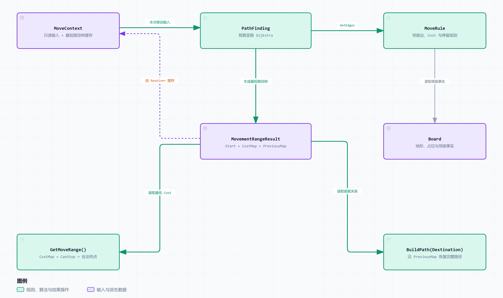

# 棋盘与移动系统

> 状态：架构方向已确定，正式接口细节与六边形实现验证待完成。已有六边形网格与 A* 来自用户既有项目，尚未接入本仓库；另有独立方格 TypeScript 演示，见[实现记录](../../Implementation/Movement/方格移动原型.md)。
>
> 决策依据：[ADR-007：移动系统与寻路算法解耦](../Decisions/ADR-007-移动系统与寻路算法解耦.md)。本文细化建议接口和流程；架构已确定不表示这些接口已定稿或实现已完成。

## 1. 职责与范围

移动子系统根据当前单位条件执行一次预算范围搜索，得到可复用的最短路径树；范围查询与目标路径恢复共享该结果，再输出待执行计划。第一版复用六边形棋盘及适合复用的搜索组件，已有 A* 保留为独立单目标能力；不在此设计动画、逐格 Hook、移动中断或完整战斗流程。



[交互图](../Diagrams/movement-architecture.html) · [SVG](../Diagrams/movement-architecture.svg) · [迁移清单](../../Implementation/Movement/六边形网格与AStar迁移清单.md)

## 2. 模块与依赖

| 模块 | 负责 | 不负责 |
| --- | --- | --- |
| Board | 格子、邻接、地形、高度、占位事实 | 按单位判断通行或停留 |
| CombatState | 当前单位位置、预算和移动能力 | 保存范围搜索的距离、前驱 |
| MoveContext | 输入快照与短期范围缓存 | 作为单位位置或预算的权威来源 |
| MoveRule | 将事实解释为边、费用和停留资格 | 操作搜索队列或真实触发移动效果 |
| PathFinding | 通过带权图搜索生成预算内最短路径树 | 读取地形枚举、Buff 或直接访问场景 Actor |
| MoveResolver | 当前输入、缓存复用、规则调用与计划输出 | 地形内容分支、位置更新、资源扣除、动画 |

PathFinding 接收通用邻接提供者；该提供者绑定只读棋盘和本次移动输入，调用 MoveRule。算法只知道节点标识与 Cost，不需要依赖具体 MoveRule 类或 MoveContext。

Board 的六边形 / 方形坐标、邻接生成和越界判断封装在棋盘实现内。对角穿角等具体玩法限制可由规则解释，但不进入搜索器。

CombatState 的位置与 Board 的占位必须通过一个权威写入入口保持一致，或是同一底层事实的不同视图。索引实际存在哪个对象上待定；不能双方独立修改后靠查询猜测哪个有效。

## 3. 建议数据结构

以下是概念字段，不规定 UE 反射、容器或指针类型。

| 数据 | 核心字段 / 语义 |
| --- | --- |
| MoveInput | UnitId、StartCell、MoveBudget、MovementType 及必要移动状态；一次搜索中固定 |
| MoveContext | Input，加可选 CachedRange；MoveRule 只看 Input |
| Edge | ToCell、Cost，表达从当前节点出发的有向转移 |
| MovementRangeResult | Start、CostMap、PreviousMap；以 Start 为根、覆盖预算内所有可达格的最短路径树 |
| CachedRange | CacheKey、MovementRangeResult，加可选 StoppableCells |
| MoveAction | UnitId、StartCell、Destination、Path、TotalCost、规划版本依据；待执行计划 |

核心数据和搜索代码可优先使用普通 struct / C++ 类。是否在引擎入口增加 USTRUCT 或 UObject，留待具体蓝图、资产及生命周期需求，不要求每个格子和每次搜索结果对象化。

MoveAction 中的 StartCell 是解析所得；MoveCommand 仍只保存 UnitId 和 Destination。计划携带起点便于交接校验，不意味着上层可以信任旧指令里的位置。

MovementRangeResult.Start 来自本次 MoveInput.StartCell。CostMap 保存预算内最低累计费用，PreviousMap 对每个非起点可达格保留一个前驱；起点 Cost 为 0、无前驱。这是一棵最短路径树，包含可经过但不可停留的节点，不能在生成范围高亮时删去这些前驱。

同一 Result 支持 GetMoveRange 和 BuildPath 两种逻辑操作。它们可以实现为便捷成员或辅助函数，均消费现有树，不触发搜索；具体结构示例见 ADR-007 第 4.2 节。

## 4. 规则与搜索接口

### Board 与 MoveRule

```text
Board.GetAdjacentCells(Cell) -> 邻接候选
Board.GetCellFacts(Cell)     -> 地形、高度等事实
Board.GetOccupancy(Cell)     -> 当前一致占位视图

MoveRule.GetEdges(Input, From) -> [Edge]
MoveRule.CanStop(Input, Cell)  -> bool
```

MoveRule 在内部统一评估转移是否允许及其费用。CanTraverse / GetMoveCost 可作为内部函数，不要求搜索器组合多个业务判断。

不可停留不等于不可经过。例如友军格可参与路径扩展，但从最终目标集合排除。规则还需正确识别查询单位自身占位，不能把起点误判为其他单位阻挡。

### PathFinding

```text
SearchRange(Start, Budget, EdgeProvider) -> MovementRangeResult

基于已有 Result：
GetMoveRange(StopPredicate) -> 合法终点集合
BuildPath(Destination) -> Path 或明确失败
```

SearchRange 采用预算受限 Dijkstra，按实际累计 Cost 扩展，完成预算内整棵树。它不需要预先指定终点，匹配移动范围和路径共享结果的需求；算法比较见 ADR-007 第 3.2 节。也可复用现有搜索代码，以 h = 0、去掉单目标提前结束条件实现同样的 Dijkstra 搜索。

GetMoveRange 读取 CostMap，并使用同版本的 CanStop 判断筛选终点。停留判断由 Resolver 显式传入或绑定，Result 不长期持有可变规则或棋盘。BuildPath 只从 Destination 沿 PreviousMap 追溯至 Start，读取 CostMap 判断是否可达；合法移动目标的停留校验由入口完成。

已有 A* 是独立能力，不属于上述查询 / 指令的另一条主要流程，也不在 Context 缓存缺失时自动替代树搜索。可以继续适配同一个 EdgeProvider；其单目标结果不得充当完整 MovementRangeResult。需要保留最短路保证时，外部启发函数使用非负费用下界、目标估价为 0，无重开节点机制时还需满足一致性；细节留在迁移核对中。

堆、松弛和前驱等可共用代码以现有实现核对结果为准，不要求为此合并成复杂搜索框架。

### 搜索契约

- 图有限，Cost 非负，预算非负；非法费用和相加溢出明确报错。
- 起点 Cost = 0，无前驱；预算恰好用尽的节点仍可达。
- 只在费用更低时更新前驱，零费用环不进行等值前驱重写。
- 邻接顺序及堆平局规则稳定，不使用散列表迭代顺序定义偏好。
- 恢复路径时检查前驱缺失与环，失败不返回部分合法路径。
- 固定 Input / Board 下，同一搜索状态的后续边由当前节点决定；朝向、沿途能力消耗等历史规则需要扩展节点状态，留待后续。

## 5. 查询与指令流程

### 范围查询

1. 校验单位，读取当前状态及移动相关版本，构建 Input。
2. 取得有效 MovementRangeResult：缓存命中则复用，缺失或失效则 SearchRange，确认版本一致后缓存到 Context。
3. 基于该 Result 调用 GetMoveRange，使用同版本 CanStop 返回合法终点与必要费用信息，不修改树。

查询可更新派生缓存，不写位置、占位、预算、Buff 或回合状态。

### 移动指令

1. 校验单位与 Destination，从当前状态构建 Input。
2. 与范围查询共用同一结果获取步骤：有有效缓存则复用，否则先 SearchRange 并缓存完整树。
3. 根据 Result.CostMap 与 CanStop 校验目标，非法则失败；合法则调用 BuildPath 恢复路径，不再次搜索。
4. 从树读取最低费用，生成 MoveAction，交上层执行，不在解析阶段扣资源或更新位置。

先下指令、再查范围也复用同一个 Result；连续预览或选择多个目标时，各自只读取树并恢复路径。此流程不走 A* 回退。独立 A* 的单目标结果不写入 CachedRange。

建议返回 InvalidUnit、InvalidDestination、Unreachable、CannotStop、StateChanged 等明确原因；具体命名和起点即目标的行为待定。起点目标不默认扣资源。

## 6. 缓存与一致性

建议在战斗作用域内，由 MoveResolver 的宿主持有 Context。MVP 可以只保留最近一次规划，暂不建立独立缓存服务。

建议缓存键包含战斗 / 棋盘身份、完整 InputKey 和保守的 MovementRevision。完整输入涵盖起点、预算及规则实际读取的单位条件；版本涵盖拓扑、地形、占位、其他单位影响与规则配置。按值或可靠版本契约判断，不仅凭简化哈希相同就复用。

所有实际依赖的修改入口需要推进版本。Dirty 与版本号都需要完整登记，不会自动识别漏掉的变化；先允许保守失效，不做局部更新。

每次 Query / Command 都从当前状态比对键。建议游戏线程内同步查询、禁止期间权威写入；若版本在搜索期间变化，丢弃结果并重算或返回 StateChanged。对外缓存视图只读，战斗结束、单位移除或上下文替换时清理。

MoveAction 的版本依据供上层在提交前核对。如果规划后位置、预算或规则发生变化，应拒绝或重解析。具体执行事务不在本稿设计。

## 7. 与其他系统的边界

- [单位系统](单位系统.md)提供移动对象与移动能力，不在单位内容中复制图算法。
- [战斗流程系统](战斗流程系统.md)决定何时允许行动、资源何时消耗、何时完成移动。
- [Command 执行机制](../Mechanisms/Command执行机制.md)后续承接计划到状态提交；移动计划不预先确定通用 Action 体系。
- [UE 集成](../Integration/UE集成与表现调度.md)承接高亮与移动表现，不使查询依赖动画。
- Buff / 技能对移动的影响进入输入与规则；真实进入效果和逐格 Hook 留待执行设计。

## 8. 迁移与验证入口

先记录现有合法路径和费用，再抽离棋盘访问与移动规则，复用适合的组件完成树搜索与结果操作，最后接入 Resolver 和 Context 缓存。已有 A* 保留独立能力，每一步都以已有六边形行为作为回归基准。

具体步骤和未接入的源码位置见 [迁移清单](../../Implementation/Movement/六边形网格与AStar迁移清单.md)；带权绕路、飞行与占位的最小案例见 [地形规则案例](../../Examples/03-扩展一种地形规则.md)。这些均是计划，当前不标记为已实现。

[返回子系统目录](README.md) · [返回 ADR](../Decisions/ADR-007-移动系统与寻路算法解耦.md)
