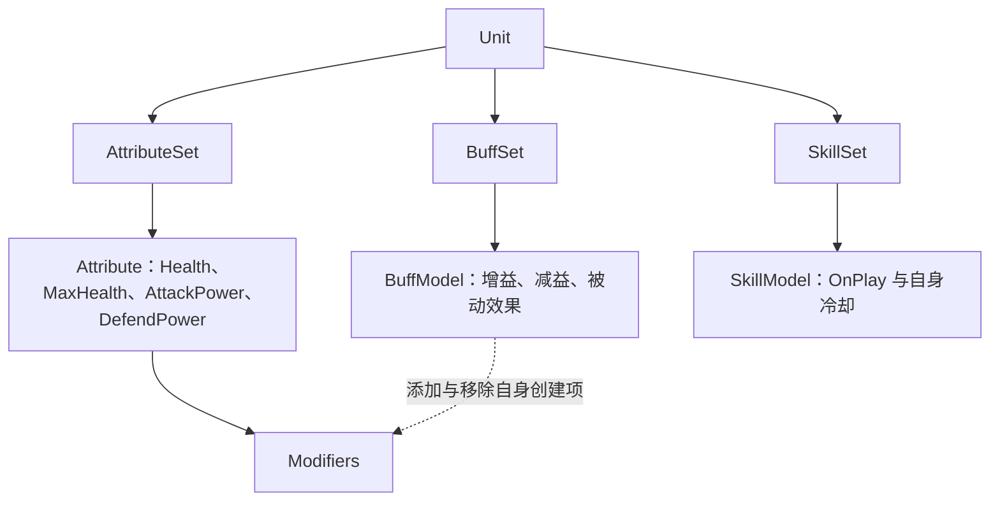

# 总体架构设计

> 状态：草案

## 1. 项目概述

本项目是基于 Unreal Engine 和 C++ 的回合制战棋框架，当前处于架构设计初期，计划首先完成最小可运行 MVP，未来作为开源项目供其他开发者使用。

本文记录高层方向及跨系统待讨论问题，不代表具体类结构或模块关系已经确定。

## 2. 设计目标与非目标

设计目标：模块化、易扩展、便于理解和测试；游戏内容保持行为内聚；规则优先通过 C++ 定义；先验证 MVP，再逐步扩展。

当前非目标：多人网络同步、复杂可视化技能编辑器，以及在初期建立复杂的可视化数据驱动体系。

### 当前设计范围与后续原型边界（已确定）

当前已在 [Prototype](../../Prototype/README.md) 中使用 TypeScript 普通类实现 Attribute、Buff、Skill、回合冷却与 CauseDamage，并接入离线 1v1 与双打 HTML。Unit 连接三个 Set，OnPlay 定义效果，Play 驱动释放；技能层确认命中，CauseDamage 按 ADR-005 处理 Direct / PercentMaxHealth、固定四阶段、概率判定和统一施加，BattleRuntime 提供共享随机源、FIFO 反应与诊断日志。通用战斗流程及 C++ 与 UE 集成仍为后续议题。

暂时忽略棋盘、位置、寻路等战棋特有机制；后续最小回合制战斗原型聚焦属性、Buff、技能与既有回合流程。

现另保留独立的 [2v2 双打版本](../../Prototype/DuoREADME.md)，允许我方两人自由安排先后、选择友方或敌方目标，新增群攻、破甲、叠毒引爆、治疗驱毒与队友强化。底层继续复用 Model、BuffCmd、DamageCmd 与全局回合派发，治疗使用最小 HealingCmd；1v1 仍作为基础验证版本保留。

原型采用统一的全局回合：所有单位完成一轮行动算一个回合。1v1 使用固定顺序，2v2 允许玩家安排己方出手顺序；这些原型规则不直接确定最终行动排序方案。

当前 HTML 原型不接入移动。用户已完成移动设计并在既有战棋项目中实现相关模块，后续需记录接口并接入；逐格进入效果、Buff 赋予施法后移动等与战斗流程的衔接继续讨论。

移动重构方向已由 [ADR-007：移动系统与寻路算法解耦](Decisions/ADR-007-移动系统与寻路算法解耦.md)确定，接口说明见 [棋盘与移动系统](Subsystems/棋盘与移动系统.md)：一次预算搜索生成含最低 Cost 与前驱的最短路径树，由 MoveContext 缓存，范围显示与目标路径恢复共享它；缓存失效时统一重建。六边形与搜索基础组件优先复用，已有 A* 保留为独立单目标能力。具体接口与实现验证仍待完成，当前 HTML 原型的范围不变。

流程细节见 [回合与战斗流程管理](Subsystems/战斗流程系统.md)。本轮原型范围不等同于完整 UE MVP 的最终范围。

本轮已实现标准对战、毒蚀叠层、受击防护三个最小场景，使用单元测试与实际浏览器验证。具体输入、规则和打开方式见 Prototype README。TODO：另行确定 UE MVP 范围及更复杂的战斗规则。

## 3. 核心架构思想

已确定：主要参考《杀戮尖塔 2》的 Hook & Model 架构，以行为内聚和规则可扩展性为目标，构建适合回合制战棋的轻量化规则系统，不采用原生 GAS 作为核心战斗架构。此处仅记录参考方向，不假定参考项目的具体内部实现。

已确定：采用 Code-First，优先通过 C++ 定义游戏规则。

决策依据见 [ADR-001](Decisions/ADR-001-选择Hook与Model架构.md) 和 [ADR-002](Decisions/ADR-002-采用Code-First开发方式.md)。

## 4. 系统总体架构

Unit 的三个主要部分与内容关系已明确：

实线表示逻辑组成或管理关系，虚线表示 BuffModel 对 Modifier 的操作关系；此图不表示 C++ 继承、物理内存所有权或代码模块依赖。Attribute 的 BaseValue、CurrentValue 与修饰器结构详见属性文档。

业务能力按单位、伤害结算、战斗流程与棋盘移动划分。属性、Buff、技能属于单位系统内部模块；Model、Hook、Command 是跨系统共用机制，UE 接入属于集成层。该划分不直接决定 UE 的 Subsystem 类或物理代码模块。

TODO：在以上职责得到验证后确定实现层次、对象生命周期和必要依赖，不提前设计完整执行框架。

## 5. 核心概念与职责边界

| 概念 | 已明确的职责或未决边界 |
| --- | --- |
| Unit | 已连接 AttributeSet、BuffSet、SkillSet，并统一提供 Model 快照与有效性判断。 |
| AttributeSet / Attribute | 原型已实现生命、攻防及暴击/格挡概率与倍率，使用精确字符串标识、BaseValue、只读 CurrentValue 和 Modifier Handle。Health 不接 Modifier，MaxHealth 接收上限增益。 |
| BuffSet / BuffModel / BuffCmd | Set 持有、查找和遍历；Model 定义效果和 Hook 响应；Cmd 统一执行施加、增减层、扣时间、移除。相同 BuffId 跨施加者合并、层数封顶、重复施加刷新时间。 |
| SkillSet / SkillModel | 已实现技能持有、查找、移除、Play、OnPlay、回合冷却和公共 Hook；具体效果通过对应 CMD 执行，完整技能流程后续讨论。 |
| Model | BuffModel 与 SkillModel 均已实现并继承 AbstractModel；基类定义 Owner 与公共 Hook。专属行为入口保留在对应 Model。 |
| Hook | 原型已实现全局回合结束、结算后受击及 Buff 命令完成后 Hook；回合开始前、角色行动前后仍待实现。TODO：完整参与范围、优先级与取消能力。 |
| Command | BuffCmd 执行效果与层数变更；CauseDamage 按 ADR-005 执行 Direct / PercentMaxHealth 四阶段与统一施加，后续伤害/治疗通过 BattleRuntime 排队。当前契约和未决扩展见 [伤害结算实现](../Implementation/Prototype/伤害结算实现.md)；正式规则见 [ADR-005](Decisions/ADR-005-伤害结算流程.md)。通用 Command / Action 执行框架仍待设计。 |
| Action | TODO：是否需要与 Command 分离？若保留，如何界定职责？ |
| Context | TODO：是否需要统一上下文？其数据范围、可变性和有效期如何定义？ |

业务职责、公共机制、集成方式与规则决策分别由 Subsystems、Mechanisms、Integration、Decisions 维护，原型接口与验证记录归入 Implementation。具体 C++ 类定义和物理对象所有权仍待确定。

## 6. 战斗执行流程

已确定：所有单位完成一轮行动算一个全局回合，回合内单位依次行动；单个单位取得并交出行动权的区间称为“单位行动阶段”。“回合开始前”对应全局回合开始前的 Hook 时机，供 Buff 等 Model 参与结算；具体参与范围与执行顺序仍待明确。

已确定：“角色行动前”和“角色行动后”也是 Hook 时机；Buff 持续时间按全局回合计数，在全局回合结束时扣减。细节分别由 [Hook 系统](Mechanisms/Hook派发机制.md) 和 [Buff 系统](Subsystems/单位系统.md#buff) 维护。

TODO：明确从行为提出、校验、规则结算到结果呈现的协作方式，以及 Hook 介入时机、失败处理和战斗结束条件。当前不规定这些环节的调用顺序或执行载体。

执行机制见 [Command 与 Action](Mechanisms/Command执行机制.md)，战斗阶段见 [回合与战斗流程](Subsystems/战斗流程系统.md)。

## 7. Unreal Engine 集成策略

已确定：使用 Unreal Engine 和 C++；原生 GAS 不承担核心战斗架构。

TODO：确定战斗规则与 UE 对象的边界，Model 与 Actor 的关联方式、对象生命周期，以及逻辑结算与动画表现的协调方式。详见 [UE 集成与表现调度](Integration/UE集成与表现调度.md)。

## 8. 文档分类索引

| 分类 | 维护内容 | 入口 |
| --- | --- | --- |
| 业务子系统 | 单位系统（含属性、Buff、技能）、伤害结算、战斗流程、棋盘移动。 | [Subsystems](Subsystems/README.md) |
| 公共机制 | Model、Hook 派发、Command 执行。 | [Mechanisms](Mechanisms/README.md) |
| 集成设计 | UE 对象、Actor、生命周期和表现协作。 | [Integration](Integration/README.md) |
| 规则与契约决策 | 公式、Hook 时序、接口边界及其理由。 | [ADR 索引](../README.md) |
| 原型实现 | 当前接口、实际行为、具体示例和验证记录。 | [Implementation](../Implementation/README.md) |

这些是文档职责分类，不要求为每个目录新增运行时管理器。

## 9. 待解决的架构问题

- Health 为无 Modifier 的剩余生命；CauseDamage 按 ADR-005 执行概率、伤害及死亡通知，HealingCmd 独立治疗。通用治疗 Hook、复活与最大生命变化后的裁剪仍待讨论。
- 已实现 ADR-003 公式、立即重算与单次添加 Handle 追踪，UE 映射与其他数值规则待讨论。
- 已实现 Buff 同标识合并、叠层封顶、刷新时间和当前回合末先效果后扣时间；多来源归因待讨论。
- 已实现单目标 OnPlay 与成功释放后开始、全局回合末递减的技能冷却；完整释放流程继续讨论。
- TODO：限定后续 MVP 必须支持的内容、验收结果和规则复杂度。
- TODO：确定状态所有权、对象生命周期和模块依赖，避免多个系统重复维护同一事实。
- TODO：界定 Command、Action、Hook、Context 的协作契约。
- TODO：确定规则顺序、嵌套触发、失败处理及结果可复现性的要求。
- TODO：明确测试边界、诊断信息和开源扩展接口的最小范围。

[返回文档入口](../README.md)
